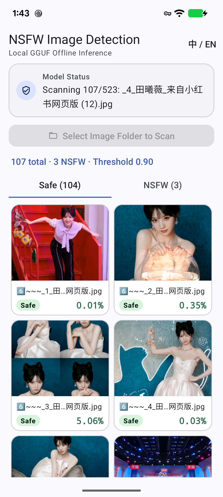

# NSFW Image Detection GGUF — Android 客户端

基于 `Falconsai/nsfw_image_detection`（ViT-B/16）GGUF 模型的 **Android 纯本地离线 NSFW 图片检测应用**。  
通过 JNI 复用桌面端 [`_nsfw_tool`](../_nsfw_tool) 中的 `ggml` CPU 后端与 `stb_image`，无需 Python 或云端服务，直接在手机本地完成批量图片文件夹检测。

<p align="center">
  
</p>

---

## ✨ 功能特性

- **Material Design 3 界面**：采用 `Theme.Material3.DayNight.NoActionBar`（支持浅色/深色模式自动切换），包含 `MaterialToolbar`、圆角卡片、Material 3 `Slider` 阈值滑块、`LinearProgressIndicator` 进度条、`Safe` / `NSFW` 分类 Tab 以及 2 列缩略图宫格列表。
- **选择文件夹批量识别**：通过系统 SAF（`OpenDocumentTree`）选择图片文件夹后，后台自动递归扫描子目录中的常见图片格式（`jpg` / `jpeg` / `png` / `webp` / `bmp` / `gif` / `heic` / `heif` / `avif`，自动跳过 `.` 开头的隐藏文件/目录），按相对路径排序并逐张评分。扫描期间自动隐藏判定阈值模块以释放列表空间，扫描结束后恢复显示。
- **NSFW 自动隔离至内部目录**：全部扫描完成后若检出 NSFW 图片，自动弹窗询问是否移动至软件内部私有目录（`files/nsfw`），确认后安全复制并移除原目录对应文件，防止系统相册继续索引。
- **实时阈值调整与多语言切换**：支持 `0.00` ~ `1.00`（默认 `0.90`）拖动实时重算合规/NSFW 统计与列表分类；支持跟随系统语言（简体中文 / English）及顶部 `中 / EN` 一键切换。
- **模型在线下载与断点续传**：
  - 首次启动未检测到模型时，支持从 GitHub Releases 下载 `nsfw_image_detection.fp32.gguf`（约 327 MB）。
  - 支持 HTTP `Range` 断点续传（`.part` 临时文件）、失败自动重试（最多 3 次）、移动网络下载提醒以及 `SHA256` 完整性校验。
- **本地导入 `.gguf` 模型**：支持通过文件选择器导入本地模型，自动校验 `GGUF` 文件头与 `SHA256`。
- **纯本地 CPU 原生推理**：基于 CMake + NDK 将 `ggml`（`ggml-cpu`）静态链接进 `libnsfwimagedetectiongguf.so`，图片预处理与桌面端 C++ 引擎一致（Pillow 12 兼容双线性插值），并统一开启 `-O3` 编译优化。

---

## 📂 目录结构

```text
android/
├── app/
│   ├── build.gradle.kts                     # 应用构建配置（minSdk 26, targetSdk 37, arm64-v8a / x86_64）
│   └── src/main/
│       ├── AndroidManifest.xml
│       ├── cpp/
│       │   ├── CMakeLists.txt               # 引用 ../_nsfw_tool/ggml 与 third_party/stb
│       │   ├── nsfw_core.h / nsfw_core.cpp  # ViT-B/16 前向推理与内存图像解码实现
│       │   └── nsfw_jni.cpp                 # JNI 桥接层
│       ├── java/com/xlzhen/nsfwimagedetectiongguf/
│       │   ├── MainActivity.kt              # 主界面、模型管理、SAF 文件夹扫描与调度
│       │   └── NsfwEngine.kt                # Kotlin 推理引擎封装
│       └── res/
│           ├── layout/
│           │   ├── activity_main.xml        # Material Design 3 主界面布局
│           │   └── item_result.xml          # 识别结果卡片布局
│           ├── drawable/                    # 矢量图标与状态胶囊背景
│           └── values/ & values-night/      # Material 3 浅色/深色主题与色彩定义
├── gradle/libs.versions.toml                # 依赖版本目录
├── build.gradle.kts
└── settings.gradle.kts
```

---

## 🛠️ 环境要求与编译

### 环境要求

- **Android Studio**（或 JDK 11+ 与 Android SDK Platform 37）
- **Android NDK** 与 **CMake 3.22.1+**
- 需要保留仓库上级目录中的 `../_nsfw_tool/ggml` 与 `../_nsfw_tool/third_party/stb`（CMake 构建时直接引用）
- **目标架构**：仅支持 64 位 ABI（`arm64-v8a`、`x86_64`），不支持 32 位设备（300 MB+ 模型无法在 32 位进程地址空间中加载）

### 编译命令

在 `android/` 目录下执行：

```bash
# Windows
.\gradlew.bat :app:assembleDebug

# macOS / Linux
./gradlew :app:assembleDebug
```

或使用 Android Studio 直接打开 `android/` 目录，等待 Gradle 同步完成后点击 **Run** 安装到真机或 64 位模拟器。

---

## 📖 使用说明

1. **准备模型**：
   - **在线下载**：点击“下载模型”（支持中断后“继续下载”断点续传）；
   - **本地导入**：若已在电脑端下载 `nsfw_image_detection.fp32.gguf`，可将其复制到手机后点击“本地导入”。
   - 模型校验通过后会自动保存至应用私有外部存储目录 `models/nsfw_image_detection.fp32.gguf` 并自动加载，后续启动免重复配置。
2. **调整阈值**：通过滑块设置 NSFW 判定阈值（默认 `0.90`）。
3. **选择图片文件夹检测**：点击“选择图片文件夹检测”，授权并选择任意图片目录，应用将在本地自动扫描并逐张输出 `NSFW` / `安全` 结果与置信度百分比。

---

## 🔒 隐私说明

- 所有图片读取、解码与模型推理均在设备本地完成，绝不上传任何图片或检测结果。
- 应用申请 `INTERNET` 与 `ACCESS_NETWORK_STATE` 权限仅用于按用户主动操作下载模型文件及检测当前是否为移动网络。

